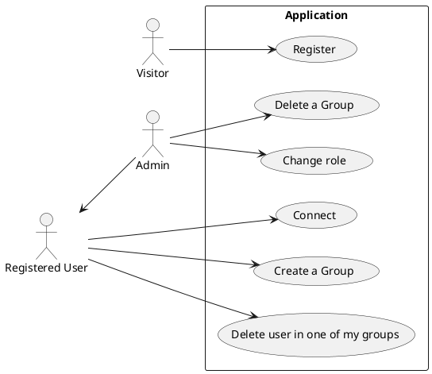
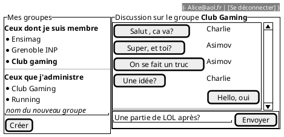

---
title: Projet React 
author:  
- A compléter avec vos noms
--- 

## Installation

Donner les éléments pour installer l'application sur une machine nue à partir de votre dépôt

En mode développement : 

~~~bash
cd frontend;npm install;npm run dev #frontend en mode développement (accessible à http://localhost:5173)
commande # pour lancer les tests frontend
cd backend;npm install;npm run stardev # backend en mode développement avec accès à l'api via http://localhost:3000/api
#cd backend;npm install;npm run startdev:proxyreact #backend en mode développement avec un accès à l'application react via un proxy à http://localhost:3000/ et l'api à http://localhost:3000/api
commande # pour lancer les tests backend ?
~~~

En mode production :

~~~bash
cd frontend;npm install;npm run build # génération du frontend dans frontend/dist
cd backend;npm install;npm run start # backend
firefox https://xxx.scalingo.ioscalingo/ # pour accéder à l'application si déployé en ligne
firefox https://xxx.scalingo.ioscalingo/docs # pour accéder à la doc scalingo si déployé en ligne
~~~

## Cahier des charges

Ici vous décrivez les fonctionnalités souhaitées et celles effectivement mises en oeuvre. Avec un diagramme UML des cas d'usage et des maquettes des vues souhaitées et des captures d'écran de ce qui a été réalisé.

### Cas d'usage

A modifier/compléter 



### Maquettes

A modifier/compléter...



### Captures d'écran

A compléter

### API mise en place

Documentation Swagger disponible sur `/doc` lorsque le serveur est démarré.

#### Authentification

| ENDPOINT | GET | POST | PUT | DELETE | Description |
|----------|-----|------|-----|--------|-------------|
| `/api/auth/register` | | ✅ Public | | | Inscription : **name, email, password** → Retourne tokens JWT |
| `/api/auth/login` | | ✅ Public | | | Connexion : **email, password** → Retourne tokens JWT |
| `/api/auth/refresh` | | ✅ Public | | | Rafraîchir le token d'accès : **refreshToken** |
| `/api/auth/logout` | | ✅ Public | | | Déconnexion : **refreshToken** |
| `/api/auth/me` | ✅ TOKEN | | | | Informations de l'utilisateur connecté |

#### Utilisateurs

| ENDPOINT | GET | POST | PUT | DELETE | Description |
|----------|-----|------|-----|--------|-------------|
| `/api/users` | ✅ TOKEN | | | | Liste tous les utilisateurs (id, name, email) |
| `/api/users/:id` | | | ✅ TOKEN (OWNER/ADMIN) | ✅ TOKEN (ADMIN) | Mettre à jour / Supprimer un utilisateur |

#### Modèles IA

| ENDPOINT | GET | POST | PUT | DELETE | Description |
|----------|-----|------|-----|--------|-------------|
| `/api/ai-models` | ✅ Public | | | | Liste des modèles IA disponibles |
| `/api/ai-models/:id` | ✅ Public | | | | Détails d'un modèle IA |

#### Demandes (Tickets)

| ENDPOINT | GET | POST | PUT | DELETE | Description |
|----------|-----|------|-----|--------|-------------|
| `/api/requests` | ✅ TOKEN | ✅ TOKEN | | | Liste ses demandes / Créer une demande : **aiModelId** |
| `/api/requests/:id` | ✅ TOKEN (OWNER/ADMIN) | | | | Détails d'une demande |
| `/api/requests/:id/approve` | | ✅ TOKEN (ADMIN) | | | Valider une demande → Déploie l'instance |
| `/api/requests/:id/reject` | | ✅ TOKEN (ADMIN) | | | Rejeter une demande |

#### Instances (Chats déployés)

| ENDPOINT | GET | POST | PUT | DELETE | Description |
|----------|-----|------|-----|--------|-------------|
| `/api/instances` | ✅ TOKEN (ADMIN) | | | | Liste toutes les instances |
| `/api/instances/:id` | ✅ TOKEN (ADMIN) | | | | Détails d'une instance |
| `/api/instances/:id/start` | | ✅ TOKEN (ADMIN) | | | Démarrer une instance |
| `/api/instances/:id/stop` | | ✅ TOKEN (ADMIN) | | | Arrêter une instance |
| `/api/instances/:id/restart` | | ✅ TOKEN (ADMIN) | | | Redémarrer une instance |
| `/api/instances/:id/logs` | ✅ TOKEN (ADMIN) | | | | Voir les logs d'une instance |
| `/api/instances/:id` | | | | ✅ TOKEN (ADMIN) | Supprimer une instance |

**Légende :**
- ✅ = Route disponible
- TOKEN = Nécessite un token JWT valide (header: `Authorization: Bearer <token>`)
- ADMIN = Nécessite les droits administrateur
- OWNER = Nécessite d'être le propriétaire de la ressource

## Architecture du code

### FrontEnd

Indiquer ici l'organisation de votre code. Et les choix faits pour le frontend.

~~~bash
# exemple d'arborescence commentée avec la commande 'tree'
login@pc nomProjet % tree --charset=ascii frontend
.
|-- README.md
|-- index.html
|-- package.json
|-- src
|   |-- App.css
|   |-- App.jsx
|   |-- components
|   |   `-- ComposantX.jsx # Formulaire de login
|   |-- index.css # feuille de style
|   |-- main.jsx
|   |-- utils
|   `-- views
|       `-- ViewX.jsx
~~~

### Backend

#### Schéma de votre base de donnée

```plantuml
class User {
  +id : INTEGER (PK, auto-increment)
  +name : STRING(128)
  +email : STRING(128) [unique]
  +passhash : STRING(60)
  +isAdmin : BOOLEAN
}

class AIModel {
  +id : INTEGER (PK, auto-increment)
  +name : STRING(128)
  +description : TEXT
  +dockerImage : STRING(255)
  +dockerCompose : TEXT
  +config : JSON
  +isActive : BOOLEAN
}

class Request {
  +id : INTEGER (PK, auto-increment)
  +status : ENUM(pending, approved, rejected, deployed)
  +createdAt : DATETIME
  +updatedAt : DATETIME
  +approvedAt : DATETIME
  +rejectedAt : DATETIME
  +rejectionReason : TEXT
}

class Instance {
  +id : INTEGER (PK, auto-increment)
  +name : STRING(128)
  +status : ENUM(running, stopped, error, starting, stopping)
  +dockerComposePath : STRING(255)
  +port : INTEGER
  +url : STRING(255)
  +createdAt : DATETIME
  +updatedAt : DATETIME
  +lastStartedAt : DATETIME
  +lastStoppedAt : DATETIME
}

class RefreshToken {
  +id : INTEGER (PK, auto-increment)
  +token : STRING(255) [unique]
  +userId : INTEGER (FK)
  +expiresAt : DATETIME
  +createdAt : DATETIME
}

User "1" -- "n" Request : creates
User "1" -- "n" RefreshToken : has
AIModel "1" -- "n" Request : requested_in
Request "1" -- "1" Instance : deploys
AIModel "1" -- "n" Instance : used_in
```

**Relations :**
- Un utilisateur peut créer plusieurs demandes
- Une demande est liée à un modèle IA et à un utilisateur
- Une demande validée génère une instance
- Une instance est liée à un modèle IA
- Un utilisateur peut avoir plusieurs refresh tokens

#### Architecture de votre code

Indiquer ici l'organisation de votre code. Et les choix faits pour le backend.

~~~bash
# exemple d'arborescence commentée
tree --charset=ascii backend                                                                                                          
.
|-- src
|   |-- __tests__
|   |   `-- testX.js
|   |-- app.js
|   |-- controllers
|   |   `-- controllerX.js #controlleur de api/group:id
|   |-- models
|   |   `-- modelX.js #modèle de user
|   |-- routes
|   |   `-- routeX.js #route gérant api/group{/:id}
|   |-- server.js
|   `-- util
|       |-- utilX.js #initialisation de la BD
|-- swagger_output.json
`-- bd.sqlite
~~~

### Gestion des rôles et droits

Expliquer ici les différents rôles mis en place, et comment ils sont gérés dans votre code.

- Coté backend

- Coté frontend


## Test

### Backend

Décrivez les tests faits au niveau du backend, leur couverture.

### Frontend

Décrivez les tests faits au niveau du backend, leur couverture.

## Intégration + déploiement (/3)

Décrivez ici les éléments mis en place au niveau de l'intégration continue

