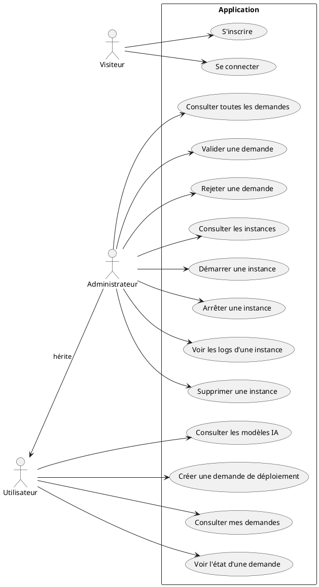

---
title: Application de Gestion et Déploiement d'Instances de Chat IA
author:  
- Elza Latifi
- Felix Picon
- Jeremy Primard
- Timothe Recoura
--- 

## Installation

<<<<<<< HEAD
### Prérequis

- Node.js (version 18 ou supérieure)
- npm ou yarn
- Git
=======
Premièrement, il faut que docker soit installé sur la machine, et que le repo soit clonné dedans (ici nous traiterons unniquement le cas ou on le déploie sur une seule machine).


En mode développement :

Notre solution va utiliser le docker-compose.yml que nous fournissons pour créer un noeud ollama.
Voici comment on le génère à la main.

1. exporter la variable OLLAMA_WEBUI_REPLICAS
```bash
export OLLAMA_REPLICAS=3
```

2. Initier le docker swarm, et déployer la solution
```bash
docker swarm init
docker stack deploy -c docker-compose.yml ollama-node
```

3. On peut voir nos containers tourner en executant la commande suivante:
```bash
docker service ls
```

4. Une fois que l'on à fini avec notre environment de développement, on arrête/supprime notre swarm
```bash
docker stack rm ollama-node
docker swarm leave --force
```
>>>>>>> origin/main

### Variables d'environnement

Créer un fichier `.env` dans le dossier `backend/` avec les variables suivantes :

```bash
PORT=3000
DB=bd.sqlite
ACCESS_TOKEN_SECRET=votre_secret_jwt_access_token
REFRESH_TOKEN_SECRET=votre_secret_jwt_refresh_token
ACCESS_TOKEN_EXPIRY=1h
REFRESH_TOKEN_EXPIRY=7d
```

### Installation en mode développement

**Frontend :**
```bash
cd frontend
npm install
npm run dev
# Frontend accessible sur http://localhost:5173
```

**Backend :**
```bash
cd backend
npm install
npm run startdev
# Backend accessible sur http://localhost:3000/api
# Documentation Swagger sur http://localhost:3000/doc
```

**Backend avec proxy React (tout sur le port 3000) :**
```bash
cd backend
npm install
npm run startdev:proxyreact
# Application complète accessible sur http://localhost:3000/
# API sur http://localhost:3000/api
# Documentation sur http://localhost:3000/doc
```

**Tests :**
```bash
# Tests backend
cd backend
npm test

# Tests frontend (à implémenter)
cd frontend
npm test
```

### Installation en mode production

```bash
# Build du frontend
cd frontend
npm install
npm run build
# Génère les fichiers statiques dans frontend/dist

# Démarrage du backend
cd backend
npm install
npm run start
# Le backend sert automatiquement les fichiers statiques du frontend
```

**Accès :**
- Application : `http://localhost:3000/`
- API : `http://localhost:3000/api`
- Documentation : `http://localhost:3000/doc`

## Cahier des charges

Ici vous décrivez les fonctionnalités souhaitées et celles effectivement mises en oeuvre. Avec un diagramme UML des cas d'usage et des maquettes des vues souhaitées et des captures d'écran de ce qui a été réalisé.

### Cas d'usage



**Fonctionnalités implémentées :**
- ✅ Authentification (inscription, connexion, déconnexion)
- ✅ Gestion des utilisateurs
- ✅ Système de tokens JWT avec refresh tokens
- ⏳ Sélection de modèles IA (à implémenter)
- ⏳ Création de demandes (à implémenter)
- ⏳ Gestion des demandes par admin (à implémenter)
- ⏳ Gestion des instances Docker (à implémenter)

### Maquettes

**Page d'accueil / Connexion :**
- Formulaire de connexion (email, mot de passe)
- Lien vers l'inscription
- Affichage des modèles IA disponibles (même sans être connecté)

**Tableau de bord utilisateur :**
- Liste des modèles IA disponibles avec description
- Formulaire de création de demande (sélection du modèle IA)
- Liste de mes demandes avec leur statut (pending, approved, rejected, deployed)
- Détails d'une demande (date de création, statut, modèle IA demandé)

**Tableau de bord administrateur :**
- Liste de toutes les demandes (tous les utilisateurs)
  - Filtres par statut
  - Actions : Valider / Rejeter
- Liste des instances déployées
  - Statut de chaque instance (running, stopped, error)
  - Actions : Démarrer / Arrêter / Redémarrer / Voir logs / Supprimer
  - Informations : Port, URL, date de création

**Vue détail instance :**
- Informations de l'instance
- Logs en temps réel
- Contrôles (start/stop/restart)

### Captures d'écran

A compléter

### API mise en place

Documentation Swagger disponible sur `/doc` lorsque le serveur est démarré.

#### Authentification

| ENDPOINT | GET | POST | PUT | DELETE | Description |
|----------|-----|------|-----|--------|-------------|
| `/api/auth/register` | | ✅ Public | | | Inscription : **name, email, password** → Retourne tokens JWT |
| `/api/auth/login` | | ✅ Public | | | Connexion : **email, password** → Retourne tokens JWT |
| `/api/auth/refresh` | | ✅ Public | | | Rafraîchir le token d'accès : **refreshToken** |
| `/api/auth/logout` | | ✅ Public | | | Déconnexion : **refreshToken** |
| `/api/auth/me` | ✅ TOKEN | | | | Informations de l'utilisateur connecté |

#### Utilisateurs

| ENDPOINT | GET | POST | PUT | DELETE | Description |
|----------|-----|------|-----|--------|-------------|
| `/api/users` | ✅ TOKEN | | | | Liste tous les utilisateurs (id, name, email) |
| `/api/users/:id` | | | ✅ TOKEN (OWNER/ADMIN) | ✅ TOKEN (ADMIN) | Mettre à jour / Supprimer un utilisateur |

#### Modèles IA

| ENDPOINT | GET | POST | PUT | DELETE | Description |
|----------|-----|------|-----|--------|-------------|
| `/api/ai-models` | ✅ Public | | | | Liste des modèles IA disponibles |
| `/api/ai-models/:id` | ✅ Public | | | | Détails d'un modèle IA |

#### Demandes (Tickets)

| ENDPOINT | GET | POST | PUT | DELETE | Description |
|----------|-----|------|-----|--------|-------------|
| `/api/requests` | ✅ TOKEN | ✅ TOKEN | | | Liste ses demandes / Créer une demande : **aiModelId** |
| `/api/requests/:id` | ✅ TOKEN (OWNER/ADMIN) | | | | Détails d'une demande |
| `/api/requests/:id/approve` | | ✅ TOKEN (ADMIN) | | | Valider une demande → Déploie l'instance |
| `/api/requests/:id/reject` | | ✅ TOKEN (ADMIN) | | | Rejeter une demande |

#### Instances (Chats déployés)

| ENDPOINT | GET | POST | PUT | DELETE | Description |
|----------|-----|------|-----|--------|-------------|
| `/api/instances` | ✅ TOKEN (ADMIN) | | | | Liste toutes les instances |
| `/api/instances/:id` | ✅ TOKEN (ADMIN) | | | | Détails d'une instance |
| `/api/instances/:id/start` | | ✅ TOKEN (ADMIN) | | | Démarrer une instance |
| `/api/instances/:id/stop` | | ✅ TOKEN (ADMIN) | | | Arrêter une instance |
| `/api/instances/:id/restart` | | ✅ TOKEN (ADMIN) | | | Redémarrer une instance |
| `/api/instances/:id/logs` | ✅ TOKEN (ADMIN) | | | | Voir les logs d'une instance |
| `/api/instances/:id` | | | | ✅ TOKEN (ADMIN) | Supprimer une instance |

**Légende :**
- ✅ = Route disponible
- TOKEN = Nécessite un token JWT valide (header: `Authorization: Bearer <token>`)
- ADMIN = Nécessite les droits administrateur
- OWNER = Nécessite d'être le propriétaire de la ressource

## Architecture du code

### FrontEnd

**Framework :** React 19.2.0 avec Vite 7.2.4

**Structure actuelle :**
```
frontend/
├── index.html              # Point d'entrée HTML
├── package.json            # Dépendances et scripts
├── vite.config.js          # Configuration Vite
├── eslint.config.js        # Configuration ESLint
└── src/
    ├── main.jsx            # Point d'entrée React
    ├── App.jsx             # Composant principal (template de base)
    ├── App.css             # Styles du composant App
    ├── index.css           # Styles globaux
    └── assets/             # Ressources statiques
        └── react.svg
```

**Choix techniques :**
- **Vite** : Build tool rapide pour le développement
- **React 19** : Framework UI moderne
- **Pas de state management** : À implémenter (Context API ou Redux)
- **Pas de routing** : À implémenter (React Router)

**À développer :**
- Composants d'authentification (Login, Register)
- Composants de gestion des demandes
- Composants d'administration
- Gestion d'état globale
- Routing entre les pages
- Appels API avec gestion des tokens

### Backend

#### Schéma de votre base de donnée

```plantuml
class User {
  +id : INTEGER (PK, auto-increment)
  +name : STRING(128)
  +email : STRING(128) [unique]
  +passhash : STRING(60)
  +isAdmin : BOOLEAN
}

class AIModel {
  +id : INTEGER (PK, auto-increment)
  +name : STRING(128)
  +description : TEXT
  +dockerImage : STRING(255)
  +dockerCompose : TEXT
  +config : JSON
  +isActive : BOOLEAN
}

class Request {
  +id : INTEGER (PK, auto-increment)
  +status : ENUM(pending, approved, rejected, deployed)
  +createdAt : DATETIME
  +updatedAt : DATETIME
  +approvedAt : DATETIME
  +rejectedAt : DATETIME
  +rejectionReason : TEXT
}

class Instance {
  +id : INTEGER (PK, auto-increment)
  +name : STRING(128)
  +status : ENUM(running, stopped, error, starting, stopping)
  +dockerComposePath : STRING(255)
  +port : INTEGER
  +url : STRING(255)
  +createdAt : DATETIME
  +updatedAt : DATETIME
  +lastStartedAt : DATETIME
  +lastStoppedAt : DATETIME
}

class RefreshToken {
  +id : INTEGER (PK, auto-increment)
  +token : STRING(255) [unique]
  +userId : INTEGER (FK)
  +expiresAt : DATETIME
  +createdAt : DATETIME
}

User "1" -- "n" Request : creates
User "1" -- "n" RefreshToken : has
AIModel "1" -- "n" Request : requested_in
Request "1" -- "1" Instance : deploys
AIModel "1" -- "n" Instance : used_in
```

**Relations :**
- Un utilisateur peut créer plusieurs demandes
- Une demande est liée à un modèle IA et à un utilisateur
- Une demande validée génère une instance
- Une instance est liée à un modèle IA
- Un utilisateur peut avoir plusieurs refresh tokens

#### Architecture de votre code

**Structure actuelle :**
```
backend/
├── package.json            # Dépendances Node.js
├── Procfile                # Configuration de déploiement
├── .eslintrc.js            # Configuration ESLint
├── swagger_output.json     # Documentation API générée
└── src/
    ├── server.js            # Point d'entrée du serveur
    ├── app.js               # Configuration Express
    ├── __tests__/
    │   └── api.user.test.js # Tests d'intégration
    ├── controllers/
    │   ├── auth.js          # Contrôleur authentification (register, login, refresh, logout, me)
    │   └── user.js          # Contrôleur utilisateurs (CRUD)
    ├── models/
    │   ├── database.js       # Configuration Sequelize
    │   ├── users.js          # Modèle User
    │   └── refreshToken.js   # Modèle RefreshToken
    ├── routes/
    │   ├── router.js         # Routeur principal
    │   ├── auth.js           # Routes /api/auth/*
    │   └── user.js           # Routes /api/users/* (legacy + nouvelles)
    ├── middleware/
    │   └── auth.js           # Middleware d'authentification (verifyToken, isAdmin, isOwnerOrAdmin)
    ├── util/
    │   ├── CodeError.js      # Classe d'erreur personnalisée
    │   ├── logger.js         # Configuration du logging
    │   ├── swagger.js        # Génération de la documentation Swagger
    │   └── updatedb.js      # Initialisation de la base de données
    └── frontend/
        └── index.html        # Page HTML de fallback
```

**Choix techniques :**
- **Express** : Framework web minimaliste
- **Sequelize** : ORM pour la gestion de la base de données
- **JWT** : Authentification avec tokens (jsonwebtoken)
- **bcrypt** : Hashage des mots de passe
- **Swagger** : Documentation API automatique
- **SQLite** : Base de données en développement
- **MariaDB** : Base de données en production (configurable)

**Pattern MVC :**
- **Models** : Définition des entités de base de données
- **Controllers** : Logique métier et gestion des requêtes
- **Routes** : Définition des endpoints API
- **Middleware** : Authentification et autorisation

### Gestion des rôles et droits

#### Rôles disponibles

1. **Utilisateur (Client)** : `isAdmin = false`
   - Peut créer des demandes de déploiement
   - Peut consulter ses propres demandes
   - Peut consulter la liste des modèles IA

2. **Administrateur** : `isAdmin = true`
   - Tous les droits utilisateur
   - Peut consulter toutes les demandes
   - Peut valider/rejeter les demandes
   - Peut gérer les instances (start/stop/logs/delete)
   - Peut gérer les utilisateurs (CRUD)

#### Implémentation côté backend

**Middleware d'authentification** (`src/middleware/auth.js`) :

1. **`verifyToken()`** : Vérifie la validité du token JWT
   - Extrait le token du header `Authorization: Bearer <token>`
   - Décode le token et récupère l'utilisateur
   - Attache `req.user` avec les informations de l'utilisateur

2. **`isAdmin()`** : Vérifie que l'utilisateur est administrateur
   - Vérifie `req.user.isAdmin === true`
   - Retourne 403 si l'utilisateur n'est pas admin

3. **`isOwnerOrAdmin()`** : Vérifie que l'utilisateur est propriétaire ou admin
   - Compare `req.user.id` avec l'ID de la ressource
   - Autorise si propriétaire OU admin

**Exemple d'utilisation :**
```javascript
// Route protégée nécessitant authentification
router.get('/users', verifyToken(), user.getUsers)

// Route nécessitant les droits admin
router.delete('/users/:id', verifyToken(), isAdmin(), user.deleteUser)

// Route nécessitant d'être propriétaire ou admin
router.put('/users/:id', verifyToken(), isOwnerOrAdmin(), user.updateUser)
```

**Token JWT :**
Le token contient les informations suivantes :
```json
{
  "id": 1,
  "email": "user@example.com",
  "isAdmin": false
}
```

#### Implémentation côté frontend

**À implémenter :**
- Stockage du token dans le localStorage ou sessionStorage
- Ajout du header `Authorization: Bearer <token>` sur toutes les requêtes API
- Redirection vers la page de login si le token est invalide/expiré
- Affichage conditionnel des éléments selon le rôle (admin vs utilisateur)
- Gestion du refresh token pour renouveler automatiquement le token d'accès


## Test

### Backend

**Framework :** Jest avec Supertest pour les tests d'intégration

**Tests existants :**
- `src/__tests__/api.user.test.js` : Test d'authentification et récupération des utilisateurs
  - Test de connexion avec email/password
  - Test de récupération de la liste des utilisateurs avec token JWT
  - Vérification du format de réponse

**Commande :**
```bash
cd backend
npm test
```

**Couverture :**
- ⏳ Tests unitaires des contrôleurs (à implémenter)
- ⏳ Tests des modèles (à implémenter)
- ⏳ Tests des middlewares (à implémenter)
- ✅ Tests d'intégration API (partiellement implémenté)

**À développer :**
- Tests de toutes les routes API
- Tests des cas d'erreur
- Tests de validation des données
- Tests de sécurité (tokens expirés, accès non autorisés)

### Frontend

**À implémenter :**
- Tests unitaires des composants (React Testing Library)
- Tests d'intégration des flux utilisateur
- Tests E2E (Cypress ou Playwright)

## Intégration + déploiement

### Intégration Continue

**À mettre en place :**
- Pipeline CI/CD (GitLab CI ou GitHub Actions)
- Exécution automatique des tests à chaque commit
- Vérification de la qualité du code (ESLint)
- Build automatique du frontend
- Déploiement automatique en staging/production

**Exemple de pipeline GitLab CI :**
```yaml
stages:
  - test
  - build
  - deploy

test_backend:
  stage: test
  script:
    - cd backend && npm install && npm test

test_frontend:
  stage: test
  script:
    - cd frontend && npm install && npm test

build:
  stage: build
  script:
    - cd frontend && npm install && npm run build
```

### Déploiement

**Backend :**
- Plateforme : Scalingo ou Heroku
- Base de données : MariaDB (fournie par la plateforme)
- Variables d'environnement à configurer :
  - `PORT` (généré automatiquement)
  - `DB` (URL de connexion MariaDB)
  - `ACCESS_TOKEN_SECRET`
  - `REFRESH_TOKEN_SECRET`
  - `ACCESS_TOKEN_EXPIRY`
  - `REFRESH_TOKEN_EXPIRY`

**Frontend :**
- Build statique servi par le backend Express
- Ou déploiement séparé sur Netlify/Vercel

**Instances Docker :**
- Les instances de chat sont déployées dynamiquement via Docker Compose
- Chaque instance utilise un port unique
- Gestion des volumes pour la persistance des données
- Monitoring des logs et de l'état des conteneurs

**Procfile (Scalingo) :**
```
web: npm run start
```

