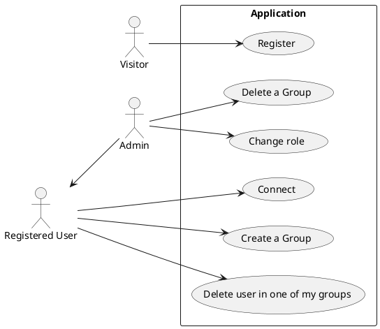
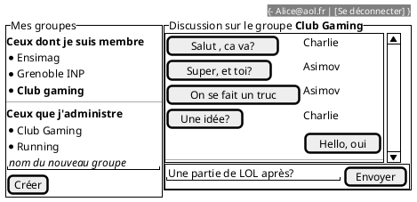

---
title: Projet React 
author:  
- A compléter avec vos noms
--- 

## Installation

Donner les éléments pour installer l'application sur une machine nue à partir de votre dépôt

En mode développement : 

~~~bash
cd frontend;npm install;npm run dev #frontend en mode développement (accessible à http://localhost:5173)
commande # pour lancer les tests frontend
cd backend;npm install;npm run stardev # backend en mode développement avec accès à l'api via http://localhost:3000/api
#cd backend;npm install;npm run startdev:proxyreact #backend en mode développement avec un accès à l'application react via un proxy à http://localhost:3000/ et l'api à http://localhost:3000/api
commande # pour lancer les tests backend ?
~~~

En mode production :

~~~bash
cd frontend;npm install;npm run build # génération du frontend dans frontend/dist
cd backend;npm install;npm run start # backend
firefox https://xxx.scalingo.ioscalingo/ # pour accéder à l'application si déployé en ligne
firefox https://xxx.scalingo.ioscalingo/docs # pour accéder à la doc scalingo si déployé en ligne
~~~

## Cahier des charges

Ici vous décrivez les fonctionnalités souhaitées et celles effectivement mises en oeuvre. Avec un diagramme UML des cas d'usage et des maquettes des vues souhaitées et des captures d'écran de ce qui a été réalisé.

### Cas d'usage

A modifier/compléter 



### Maquettes

A modifier/compléter...



### Captures d'écran

A compléter

### API mise en place

Donner le lien vers la documentation swagger et/ou faire un tableau récapitulant l'API

| ENDPOINT                | GET                                                        | POST                                                                                               | PUT                                                                                          | DELETE                                         |
|-------------------------|------------------------------------------------------------|----------------------------------------------------------------------------------------------------|----------------------------------------------------------------------------------------------|------------------------------------------------|
| /api/login              |                                                            | Obtention du token de l'utilisateur en postant les informations de connexion / **email, password** |                                                                                              |                                                |
| /api/users              | (ADMIN) Lister tous les utilisateurs                       | Créer un utilisateur / **name, email, password**                                                   |                                                                                              |                                                |
| /api/users/me           | (TOKEN) Obtenir les informations de l'utilisateur connecté |                                                                                                    | (TOKEN) Mettre à jour les informations de l'utilisateur connecté / **name, email, password** |                                                |
| /api/users/{id}         | (ADMIN) Obtenir les informations d'un utilisateur          |                                                                                                    | (ADMIN) Mettre à jour les informations de l'utilisateur / **name, email, password, isAdmin** | (ADMIN) Supprimer un utilisateur               |
| /api/chats              | (ADMIN) Lister tous les chats                              | (ADMIN) Créer un chat / **userid, model**                                                          |                                                                                              |                                                |
| /api/chats/me           | (TOKEN) Obtenir les chats de l'utilisateur connecté        |                                                                                                    |                                                                                              |                                                |
| /api/chats/{id}         | (ADMIN/OWNER) Obtenir les informations d'un chat           |                                                                                                    | (ADMIN/OWNER) Mettre à jour les informations d'un chat / **model**                           | (ADMIN/OWNER) Supprimer un chat                |
| /api/chats/{id}/send    |                                                            | (ADMIN/OWNER) Envoyer un message sur un chat                                                       |                                                                                              |                                                |
| /api/chats/{id}/history | (ADMIN/OWNER) Obtenir l'historique d'un chat               |                                                                                                    |                                                                                              | (ADMIN/OWNER) Supprimer l'historique d'un chat |

## Architecture du code

### FrontEnd

Indiquer ici l'organisation de votre code. Et les choix faits pour le frontend.

~~~bash
# exemple d'arborescence commentée avec la commande 'tree'
login@pc nomProjet % tree --charset=ascii frontend
.
|-- README.md
|-- index.html
|-- package.json
|-- src
|   |-- App.css
|   |-- App.jsx
|   |-- components
|   |   `-- ComposantX.jsx # Formulaire de login
|   |-- index.css # feuille de style
|   |-- main.jsx
|   |-- utils
|   `-- views
|       `-- ViewX.jsx
~~~

### Backend

#### Schéma de votre base de donnée

A modifier/compléter...

```plantuml
class User{
  name: string
  email: string
  password: string
  isAdmin : boolean
}

class Chat{
  model: string
  history: blob
}

User "1" -- "n" Chat : owns
```

#### Architecture de votre code

Indiquer ici l'organisation de votre code. Et les choix faits pour le backend.

~~~bash
# exemple d'arborescence commentée
tree --charset=ascii backend                                                                                                          
.
|-- src
|   |-- __tests__
|   |   `-- testX.js
|   |-- app.js
|   |-- controllers
|   |   `-- controllerX.js #controlleur de api/group:id
|   |-- models
|   |   `-- modelX.js #modèle de user
|   |-- routes
|   |   `-- routeX.js #route gérant api/group{/:id}
|   |-- server.js
|   `-- util
|       |-- utilX.js #initialisation de la BD
|-- swagger_output.json
`-- bd.sqlite
~~~

### Gestion des rôles et droits

Expliquer ici les différents rôles mis en place, et comment ils sont gérés dans votre code.

- Coté backend

- Coté frontend


## Test

### Backend

Décrivez les tests faits au niveau du backend, leur couverture.

### Frontend

Décrivez les tests faits au niveau du backend, leur couverture.

## Intégration + déploiement (/3)

Décrivez ici les éléments mis en place au niveau de l'intégration continue

