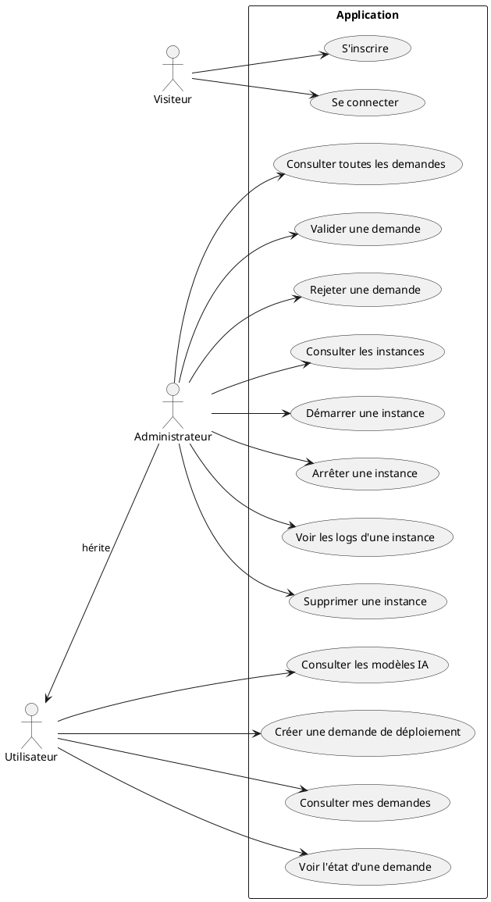
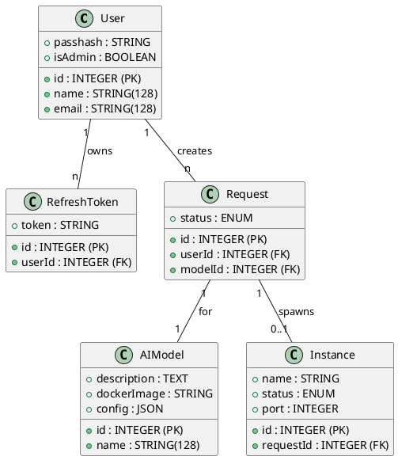

---
title: Application de Gestion et Déploiement d'Instances de Chat IA
author:  
- Elza Latifi
- Felix Picon
- Jeremy Primard
- Timothe Recoura
--- 

## Contexte du Projet

Application web de gestion et déploiement d'instances de chat IA avec système d'authentification et de tickets. 

Ce projet permet aux utilisateurs de demander le déploiement de modèles d'IA (via Ollama) et aux administrateurs de gérer ces demandes et les instances Docker associées.

## Installation

### Prérequis

- Node.js (version 20 recommandée)
- npm 
- Git
- Docker (optionnel en dév, requis en prod pour les modèles IA)

### Variables d'environnement

Créer un fichier `.env` dans le dossier `backend/` avec les variables suivantes :

```bash
PORT=3000
DB=bd.sqlite
ACCESS_TOKEN_SECRET=votre_secret_jwt_access_token
REFRESH_TOKEN_SECRET=votre_secret_jwt_refresh_token
ACCESS_TOKEN_EXPIRY=1h
REFRESH_TOKEN_EXPIRY=7d
```

### Installation en mode développement

**Frontend :**
```bash
cd frontend
npm install
npm run dev
# Frontend accessible sur http://localhost:5173
```

**Backend :**
```bash
cd backend
npm install
npm run startdev
# Backend accessible sur http://localhost:3000/api
# Documentation Swagger sur http://localhost:3000/doc
```

**Backend avec proxy React (tout sur le port 3000) :**
```bash
cd backend
npm install
npm run startdev:proxyreact
# Application complète accessible sur http://localhost:3000/
# API sur http://localhost:3000/api
# Documentation sur http://localhost:3000/doc
```

**Tests :**
```bash
# Tests backend
cd backend
npm test

# Tests frontend (à implémenter)
cd frontend
npm test
```

### Installation en mode production

Pour la production, le projet utilise un script de build personnalisé qui compile le frontend (Vite), obfusque le code, et prépare le backend.

```bash
# 1. Installation des dépendances
cd backend
npm install

# 2. Build complet (Frontend + Backend)
npm run build:backend
# Cela génère un dossier 'backend/dist' contenant l'application complète optimisée et obfusquée.

# 3. Initialisation de la base de données
npm run updatedb

# 4. Démarrage
npm run start
# Lance 'node dist/server.js'
```

**Accès :**
- Application : `http://localhost:3000/`
- API : `http://localhost:3000/api`
- Documentation : `http://localhost:3000/doc`

## Déploiement VPS

Ce projet est conçu pour être déployé sur un serveur VPS Linux (Ubuntu/Debian/Alpine).

### Installation automatisée (Recommandée)

Un script `setup_vps.sh` est fourni pour installer automatiquement les dépendances sur un VPS :
- Node.js 20
- Nginx & Certbot (HTTPS)
- Docker
- PM2

```bash
chmod +x setup_vps.sh
./setup_vps.sh
```

### Gestion du processus

En production, l'application est gérée par **PM2** :

```bash
pm2 start dist/server.js --name "app-ia"
pm2 save
pm2 startup
```

### Configuration HTTPS (Nginx)

Exemple de configuration pour utiliser Nginx comme reverse proxy (port 80/443) :

```nginx
server {
    listen 80;
    server_name votre-domaine.com;

    location / {
        proxy_pass http://localhost:3000;
        proxy_http_version 1.1;
        proxy_set_header Upgrade $http_upgrade;
        proxy_set_header Connection 'upgrade';
        proxy_set_header Host $host;
        proxy_cache_bypass $http_upgrade;
    }
}
```

Activater HTTPS avec Certbot :
```bash
sudo certbot --nginx -d votre-domaine.com
```

### Dépannage Docker

Si l'image Ollama est manquante :
```bash
docker pull ollama/ollama:latest
```

## Cahier des charges

### Cas d'usage



### Flux de Travail

1. **Client crée une demande** → État: `pending`
2. **Admin valide la demande** → État: `approved` → Déploiement Docker Compose automatique
3. **Instance créée** → État: `deployed` → Instance disponible (URL fournie)
4. **Admin gère l'instance** → Actions possibles : start, stop, restart, voir les logs, supprimer

### Fonctionnalités implémentées

**Utilisateurs (Clients) :**
- ✅ Authentification complète (inscription, connexion, déconnexion, refresh token)
- ✅ Consultation des modèles IA disponibles
- ✅ Création et suivi des demandes de déploiement

**Administrateurs :**
- ✅ Gestion des demandes (Validation/Rejet)
- ✅ Gestion des modèles IA (Recherche via Ollama API, Ajout, Suppression)
- ✅ Gestion des instances Docker (Démarrage, Arrêt, Logs, Suppression)

**Sécurité :**
- ✅ Authentification JWT (Access + Refresh Tokens)
- ✅ Hashage des mots de passe (bcrypt)
- ✅ Contrôle d'accès basé sur les rôles (RBAC) pour les routes protégées API
- ✅ Middleware d'authentification et d'autorisation (verifyToken, isAdmin, isOwnerOrAdmin)

### Maquettes

**Page d'accueil / Connexion :**
- Formulaire de connexion (email, mot de passe)
- Lien vers l'inscription
- Affichage des modèles IA disponibles (même sans être connecté)

**Tableau de bord utilisateur :**
- Liste des modèles IA disponibles avec description
- Formulaire de création de demande (sélection du modèle IA)
- Liste de mes demandes avec leur statut (pending, approved, rejected, deployed)
- Détails d'une demande (date de création, statut, modèle IA demandé)

**Tableau de bord administrateur :**
- Liste de toutes les demandes (tous les utilisateurs)
  - Filtres par statut
  - Actions : Valider / Rejeter
- Liste des instances déployées
  - Statut de chaque instance (running, stopped, error)
  - Actions : Démarrer / Arrêter / Redémarrer / Voir logs / Supprimer
  - Informations : Port, URL, date de création

**Vue détail instance :**
- Informations de l'instance
- Logs en temps réel
- Contrôles (start/stop/restart)

### Captures d'écran

A compléter

### API mise en place

Documentation Swagger disponible sur `/doc` lorsque le serveur est démarré.

#### Authentification

| ENDPOINT | GET | POST | PUT | DELETE | Description |
|----------|-----|------|-----|--------|-------------|
| `/api/auth/register` | | ✅ Public | | | Inscription : **name, email, password** → Retourne tokens JWT |
| `/api/auth/login` | | ✅ Public | | | Connexion : **email, password** → Retourne tokens JWT |
| `/api/auth/refresh` | | ✅ Public | | | Rafraîchir le token d'accès : **refreshToken** |
| `/api/auth/logout` | | ✅ Public | | | Déconnexion : **refreshToken** |
| `/api/auth/me` | ✅ TOKEN | | | | Informations de l'utilisateur connecté |

#### Utilisateurs

| ENDPOINT | GET | POST | PUT | DELETE | Description |
|----------|-----|------|-----|--------|-------------|
| `/api/users` | ✅ TOKEN | | | | Liste tous les utilisateurs (id, name, email) |
| `/api/users/:id` | | | ✅ TOKEN (OWNER/ADMIN) | ✅ TOKEN (ADMIN) | Mettre à jour / Supprimer un utilisateur |

#### Modèles IA

| ENDPOINT | GET | POST | PUT | DELETE | Description |
|----------|-----|------|-----|--------|-------------|
| `/api/ai-models` | ✅ TOKEN | ✅ ADMIN | | | Liste des modèles IA / Créer (Admin) |
| `/api/ai-models/search` | ✅ ADMIN | | | | Recherche de modèles (via Ollama) |
| `/api/ai-models/:id` | | | | ✅ ADMIN | Supprimer un modèle IA |

#### Demandes (Tickets)

| ENDPOINT | GET | POST | PUT | DELETE | Description |
|----------|-----|------|-----|--------|-------------|
| `/api/requests` | ✅ TOKEN | ✅ TOKEN | | | Liste ses demandes / Créer une demande |
| `/api/requests/admin/all` | ✅ ADMIN | | | | Liste de toutes les demandes (Admin) |
| `/api/requests/:id/approve` | | ✅ ADMIN | | | Valider une demande → Déploie l'instance |
| `/api/requests/:id/reject` | | ✅ ADMIN | | | Rejeter une demande |

#### Instances (Chats déployés)

| ENDPOINT | GET | POST | PUT | DELETE | Description |
|----------|-----|------|-----|--------|-------------|
| `/api/chats` | ✅ TOKEN | ✅ ADMIN | | | Liste des instances / Créer une instance (Admin) |
| `/api/chats/:id/status` | ✅ TOKEN | | | | Statut d'une instance |
| `/api/chats/:id/message` | | ✅ TOKEN | | | Envoyer un message à une instance |

**Légende :**
- ✅ = Route disponible et implémentée
- ⏳ = Route planifiée mais non implémentée
- TOKEN = Nécessite un token JWT valide (header: `Authorization: Bearer <token>`)
- ADMIN = Nécessite les droits administrateur
- OWNER = Nécessite d'être le propriétaire de la ressource
- Public = Route accessible sans authentification

### Architecture du code

#### FrontEnd

**Framework :** React 19.2.0 avec Vite 7.2.4

**Structure actuelle :**
```
frontend/
├── index.html              # Point d'entrée HTML
├── package.json            # Dépendances et scripts
├── vite.config.js          # Configuration Vite
├── eslint.config.js        # Configuration ESLint
└── src/
    ├── main.jsx            # Point d'entrée React
    ├── App.jsx             # Composant principal (Routing et Layout)
    ├── App.css             # Styles de l'App
    ├── index.css           # Styles globaux
    ├── contexts/           # Contextes React (AuthContext...)
    ├── components/         # Composants réutilisables (Navbar...)
    ├── pages/              # Pages de l'application
    │   ├── Login.jsx       # Page de connexion
    │   ├── Register.jsx    # Page d'inscription
    │   ├── Dashboard.jsx   # Tableau de bord utilisateur
    │   ├── Requests.jsx    # Gestion des demandes utilisateur
    │   ├── Chat.jsx        # Interface de chat
    │   ├── AdminRequests.jsx # Administration des demandes
    │   ├── AdminModels.jsx   # Administration des modèles IA
    │   └── Unauthorized.jsx  # Page non autorisé
    └── assets/             # Ressources statiques
```

#### Backend

**Structure actuelle :**
```
backend/
├── package.json            # Dépendances Node.js
├── Procfile                # Configuration de déploiement
├── swagger_output.json     # Documentation API générée
└── src/
    ├── server.js            # Point d'entrée du serveur
    ├── app.js               # Configuration Express
    ├── controllers/
    │   ├── auth.js          # Contrôleur authentification
    │   ├── user.js          # Contrôleur utilisateurs
    │   ├── aiModel.js       # Contrôleur modèles IA
    │   ├── request.js       # Contrôleur demandes
    │   └── chat.js          # Contrôleur chats
    ├── models/
    │   ├── database.js      # Configuration Sequelize
    │   ├── users.js         # Modèle User
    │   ├── refreshToken.js  # Modèle RefreshToken
    │   ├── aiModels.js      # Modèle AIModel
    │   ├── requests.js      # Modèle Request
    │   └── chats.js         # Modèle Chat/Instance
    ├── routes/
    │   ├── router.js        # Routeur racine
    │   ├── api.js           # Routeur API (/api)
    │   ├── auth.js          # Routes auth
    │   ├── user.js          # Routes users
    │   ├── aiModel.js       # Routes modèles IA
    │   ├── request.js       # Routes demandes
    │   └── chat.js          # Routes chats
    ├── middleware/
    │   └── auth.js          # Middleware Auth & Admin
    └── util/                # Utilitaires (Logger, Swagger, DB...)
```

**Choix techniques :**
- **Express** : Framework web minimaliste
- **Sequelize** : ORM pour la gestion de la base de données
- **JWT** : Authentification avec tokens (Access + Refresh)
- **Swagger** : Documentation API automatique
- **SQLite** : Base de données en développement
- **Dockerode** : Gestion des conteneurs Docker pour les instances
- **Esbuild** : Bundler et obfuscation pour la production

**Pattern MVC :**
- **Models** : Définition des entités de base de données
- **Controllers** : Logique métier et gestion des requêtes
- **Routes** : Définition des endpoints API
- **Middleware** : Authentification et autorisation

### Gestion des rôles et droits

#### Rôles disponibles

1. **Utilisateur (Client)** : `isAdmin = false`
   - Peut consulter la liste des utilisateurs
   - Peut modifier ses propres informations
   - ✅ Peut créer des demandes de déploiement
   - ✅ Peut consulter ses propres demandes
   - ✅ Peut consulter la liste des modèles IA
   - ✅ Peut interagir avec ses instances de chat

2. **Administrateur** : `isAdmin = true`
   - Tous les droits utilisateur
   - Peut gérer tous les utilisateurs
   - ✅ Peut consulter et gérer toutes les demandes (valider/rejeter)
   - ✅ Peut gérer les modèles IA (ajouter/supprimer/rechercher)
   - ✅ Peut gérer les instances de chat

### Schéma de la base de données

**Modèles implémentés :**



## Intégration + déploiement

### Intégration Continue

**À mettre en place :**
- Pipeline CI/CD (GitLab CI ou GitHub Actions)
- Exécution automatique des tests à chaque commit
- Vérification de la qualité du code (ESLint)
- Build automatique du frontend
- Déploiement automatique en staging/production

### Déploiement

**Backend & Frontend :**
- Application monolithique (Backend + Frontend intégré) après build
- Déploiement sur VPS Linux (Alpine/Debian/Ubuntu)
- Reverse Proxy Nginx + Certbot pour HTTPS
- Gestion des processus via PM2

**Instances Docker :**
- Les instances de chat sont déployées dynamiquement via Docker Compose
- Chaque instance utilise un port unique
- Gestion des volumes pour la persistance des données
- Monitoring des logs et de l'état des conteneurs
